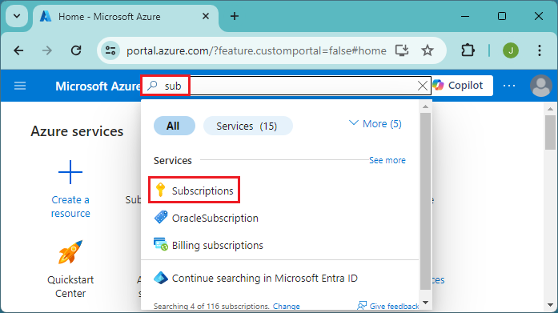

# Register the resource provider

Because Sovereign View is a new resource type in preview, you must register the `SovereignView` preview feature and its resource provider, `Microsoft.Sovereign`, in your Azure subscription before you can create a Sovereign View.

You only need to do this once per subscription.

## Prerequisites

- Complete [Module 1: Roles and Permissions](https://github.com/Azure/sovereign-control-panel-private-preview/blob/main/docs/how-to/01-roles%20and%20permissions.md).
- Use a subscription whose ID you shared in the onboarding form.

## Register the SovereignView feature in the Azure portal

1. Open the [Azure portal](https://portal.azure.com).
2. Search for **Subscriptions** and open the subscription where the SovereignView will be created.
3. In the subscription menu, open **Settings** > **Preview features**.
4. Search for **SovereignView**.
5. Select the feature and choose **Register**.
6. Refresh the page until the state is **Registered**.

## Register Microsoft.Sovereign

| # | Step | Screenshot |
| :-: | --- | --- |
| 1 | **Sign in** to the [Azure portal](https://portal.azure.com). | — |
| 2 | On the Azure portal menu, search for and select Subscriptions. |  |
| 3 | Select the subscription ID you (shared in the onboarding form) want to create the view. |  |
| 4 | On the left menu, under **Settings**, select **Resource providers**. |  |
| 5 | **Search for Microsoft.Sovereign** to register. |  |
| 6 | Click on the resource provider and select **Register**. |  |

> [!TIP]
> To maintain least privilege in your subscription, register only the resource providers that you intend to use.

Registering with the resource provider allows you to create Sovereign view resources in this subscription. You only need to do this once per subscription.

## Azure CLI steps

If SovereignView is not visible under **Preview features**, run the following commands against the same subscription where you are creating the SovereignView in a new [Cloud Shell](https://shell.azure.com/). Select **Bash** as the shell type.

Set the subscription and verify its identity:

```bash
az account set --subscription <subscription-id>

az account show \
  --query "{subscriptionId:id,name:name,tenantId:tenantId}" \
  --output table
```

Check the Microsoft.Sovereign provider registration:

```bash
az provider show \
  --namespace Microsoft.Sovereign \
  --query "{namespace:namespace,registrationState:registrationState}" \
  --output table
```

Check whether the SovereignView feature is enabled:

```bash
az feature show \
  --name SovereignView \
  --namespace Microsoft.Sovereign \
  --output table
```

If the feature is not registered, register it:

```bash
az feature register \
  --name SovereignView \
  --namespace Microsoft.Sovereign
```

The feature may initially show `Registering` or `Pending`. Wait until the state is `Registered`, then run the status command again:

```bash
az feature show \
  --name SovereignView \
  --namespace Microsoft.Sovereign \
  --output table
```

After the feature reaches `Registered`, refresh the provider registration:

```bash
az provider register \
  --namespace Microsoft.Sovereign
```

Check the provider state again:

```bash
az provider show \
  --namespace Microsoft.Sovereign \
  --query "{namespace:namespace,registrationState:registrationState}" \
  --output table
```

Finally, verify that the resource type and requested API version are exposed:

```bash
az provider show \
  --namespace Microsoft.Sovereign \
  --query "resourceTypes[?resourceType=='sovereignViews'].{resourceType:resourceType,apiVersions:apiVersions,locations:locations}" \
  --output json
```

Confirm that the output contains `resourceType: sovereignViews` and `apiVersion: 2026-07-31-preview`, then retry the SovereignView create request.

## Troubleshooting

### SovereignView `InvalidResourceType` error

The following error usually means that the subscription is not currently enabled for the `SovereignView` feature, feature registration is still pending, or provider registration has not refreshed after the feature was enabled:

```json
{
  "code": "InvalidResourceType",
  "message": "The resource type could not be found in the namespace 'Microsoft.Sovereign' for api version '2026-07-31-preview'."
}
```

Follow the [Azure CLI steps](#azure-cli-steps) above to verify that the feature and provider are registered and that the `sovereignViews` resource type exposes API version `2026-07-31-preview`. After both registrations are complete, retry the SovereignView create request.

## Next steps

- [Create a Sovereign View](/docs/how-to/03-create-sovereign-view.md)
