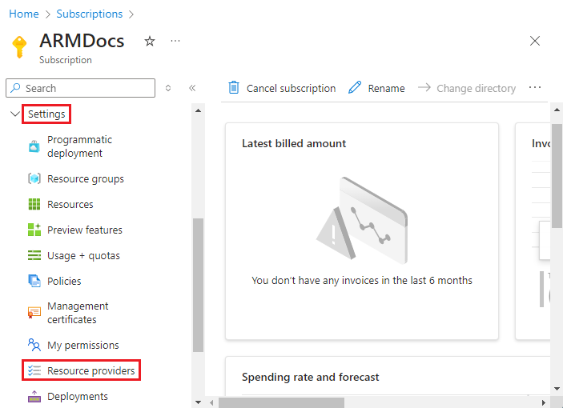

# Register the resource provider

Because Sovereign View is a new resource type in preview, you must register its resource provider, `Microsoft.Sovereign`, in your Azure subscription before you can create a Sovereign View.

You only need to do this once per subscription.

## Prerequisites

- Complete [Module 1: Prerequisites and roles](/docs/how-to/01-prerequisites-and-roles.md).
- Use a subscription whose ID you shared in the onboarding form.

## Register Microsoft.Sovereign

| # | Step | Screenshot |
| :-: | --- | --- |
| 1 | **Sign in** to the [Azure portal](https://portal.azure.com). | — |
| 2 | On the Azure portal menu, **search for and select Subscriptions**. |  |
| 3 | **Select the subscription ID** you shared in the onboarding form. |  |
| 4 | In the left menu, under **Settings**, select **Resource providers**. |  |
| 5 | **Search for Microsoft.Sovereign**. |  |
| 6 | Select the resource provider, then select **Register**. |  |

> [!TIP]
> To maintain least privilege in your subscription, register only the resource providers that you intend to use.

Registering the resource provider lets you create Sovereign View resources in this subscription.

## Next steps

- [Create a Sovereign View](/docs/how-to/03-create-sovereign-view.md)
