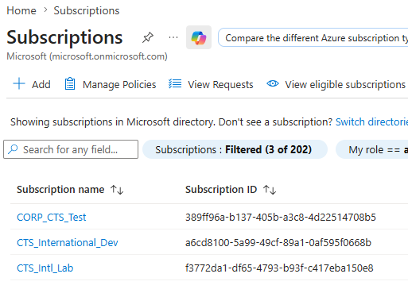
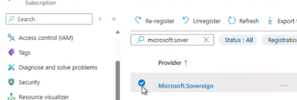
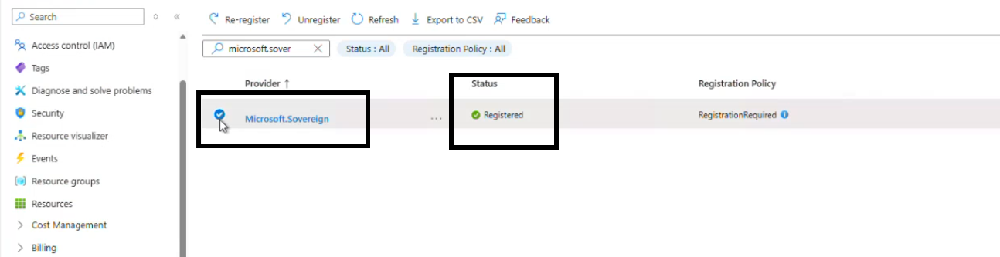

# Register the resource provider

Because Sovereign View is a new resource type in preview, you must register its resource provider, `Microsoft.Sovereign`, in your Azure subscription before you can create a Sovereign View.

You only need to do this once per subscription.

## Prerequisites

- Complete [Module 1: Prerequisites and roles](/docs/how-to/01-prerequisites-and-roles.md).
- Use a subscription whose ID you shared in the onboarding form.

## Register Microsoft.Sovereign

1. Sign in to the [Azure portal](https://portal.azure.com).

1. On the Azure portal menu, search for and select **Subscriptions**.

   

1. Select the subscription ID you shared in the onboarding form.

   

1. In the left menu, under **Settings**, select **Resource providers**.

   

1. Search for **Microsoft.Sovereign**.

   

1. Select the resource provider, and then select **Register**.

   

   > [!TIP]
   > To maintain least privilege in your subscription, register only the resource providers that you intend to use.

Registering the resource provider lets you create Sovereign View resources in this subscription.

## Next steps

- [Create a Sovereign View](/docs/how-to/03-create-sovereign-view.md)
