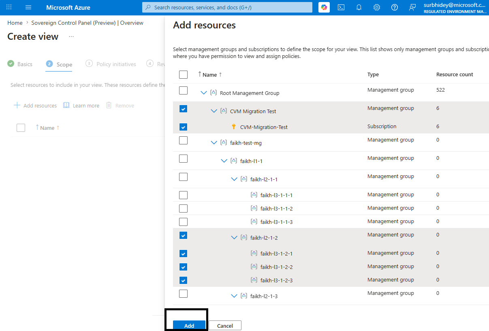
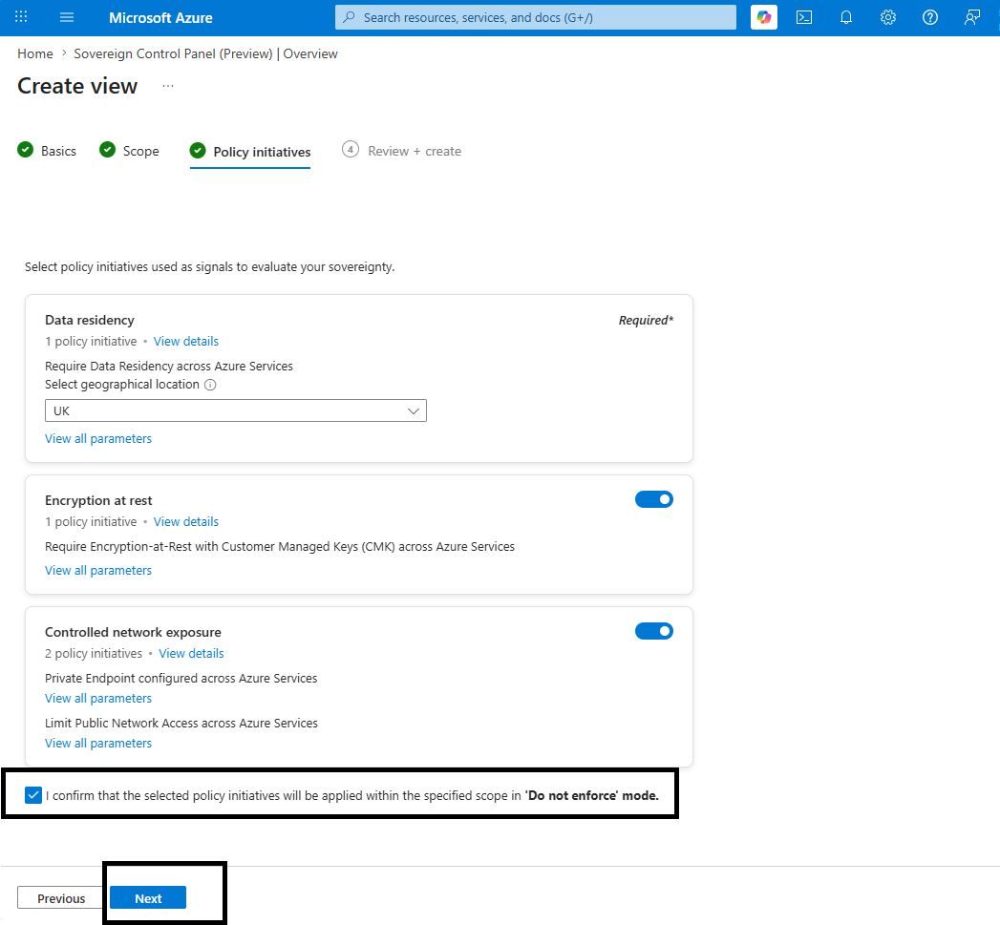
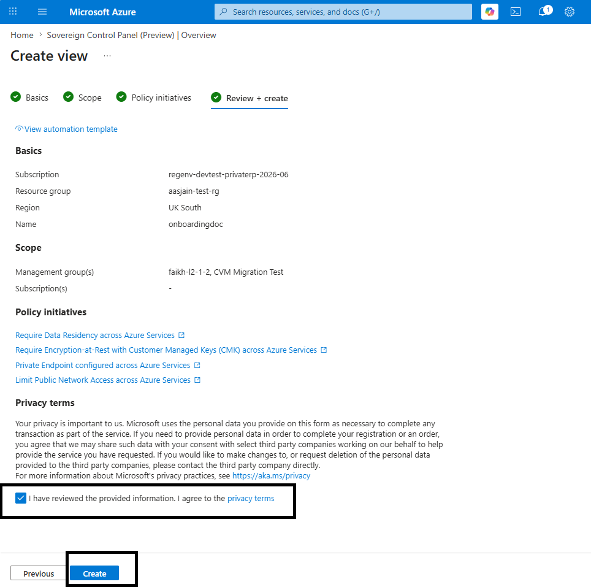

# Create a Sovereign View

After the resource provider is registered, you can create a Sovereign View resource. You can create it only on the subscriptions (in an allowlisted tenant) that you provided in the onboarding form.

## Prerequisites

- Complete [Module 2: Register the resource provider](/docs/how-to/02-register-resource-provider.md).
- Have **Contributor + Resource Policy Contributor** or **Owner** on the target subscription.

## Start the create experience

1. In the Azure portal's top search bar, type **Sovereign**, and then select **Sovereign Control Panel**.

   

1. On the overview page, select **Create View**.

   

## Complete the Basics tab

The Create view page opens with the Subscription and Resource group prefilled.

On the **Basics** tab, fill in the following details:

- **Subscription**: Choose the subscription where you want to create the Sovereign View resource (the same subscription you registered earlier).
- **Resource group**: Select an existing resource group, or create a new one to host the Sovereign View resource.
- **Name**: Enter a name for the Sovereign View resource. Spaces aren't allowed.
- **Region**: Choose an Azure region for the resource. This is where the resource metadata and processing reside.

Select **Next** to move to the **Scope** tab.

## Select the scope

1. On the **Scope** tab, select **+ Add resources**.

   

1. Choose either a **Management group** (to include all subscriptions under it) or one or more specific **Subscriptions** to include in this Sovereign View. Use the UI controls to select the desired management group and/or subscriptions from the list.

   

1. After selecting the resources, select **Add**.

   

1. On the **Scope** page, select the subscriptions or management groups you want to include. To include all available items, select the checkbox next to **Name**. When your selection is complete, select **Next**.

   

## Configure the policy initiative

The Sovereign View focuses on specific control sets (for example, Data Residency or Encryption at Rest) relevant to data sovereignty. In the preview, these are largely predefined and selected for you.

On the **Policy initiative** tab:

- **Data Residency (Geography)**: In the current preview, the default value of **Europe** is selected.
- Review the list of policies or controls that will be evaluated (for example, *Data sovereignty control levels* or *Encryption at rest*). These represent the scope definitions the Sovereign View uses.

> [!TIP]
> To learn more about any Azure policy, see its definition on the [Azure Policy](https://portal.azure.com) page in the portal, or the [list of built-in policy definitions](https://learn.microsoft.com/azure/governance/policy/samples/built-in-policies).

Select **I confirm** to allow Azure to proceed with creating the resource and its associated identities, and then select **Next**. Validation takes a few seconds.

## Review and create

1. On the **Review + create** tab, verify all configuration details (scope, name, region, and so on).

   

1. Select the confirmation checkbox, and then select **Create** to deploy the Sovereign View resource.

   

The deployment completes within a few seconds, and your Sovereign View resource is created.

## Next steps

- [Assign managed identity roles](/docs/how-to/04-assign-managed-identity-roles.md)
