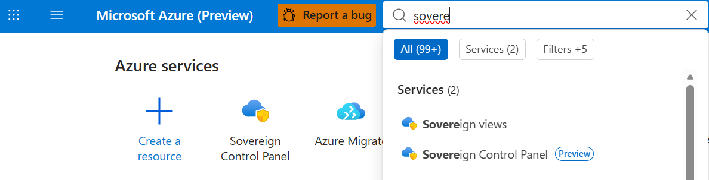
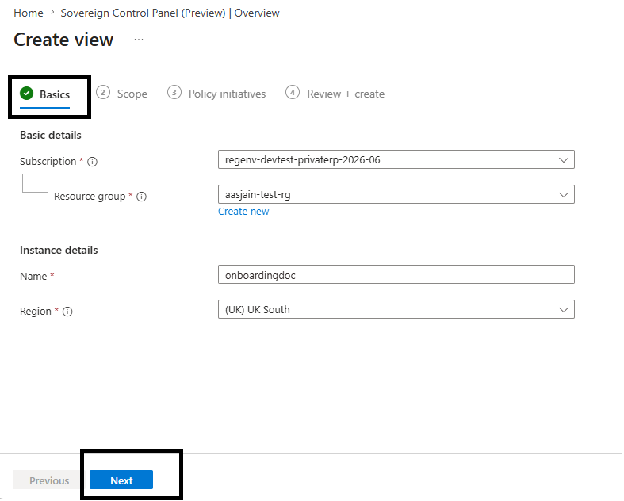
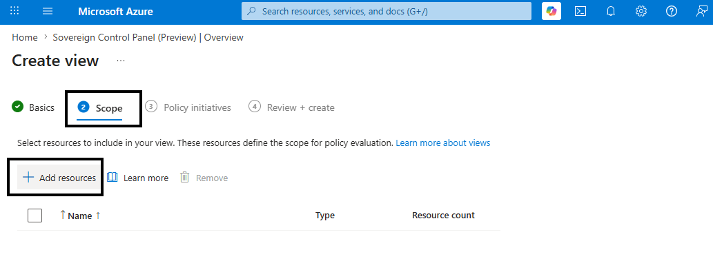
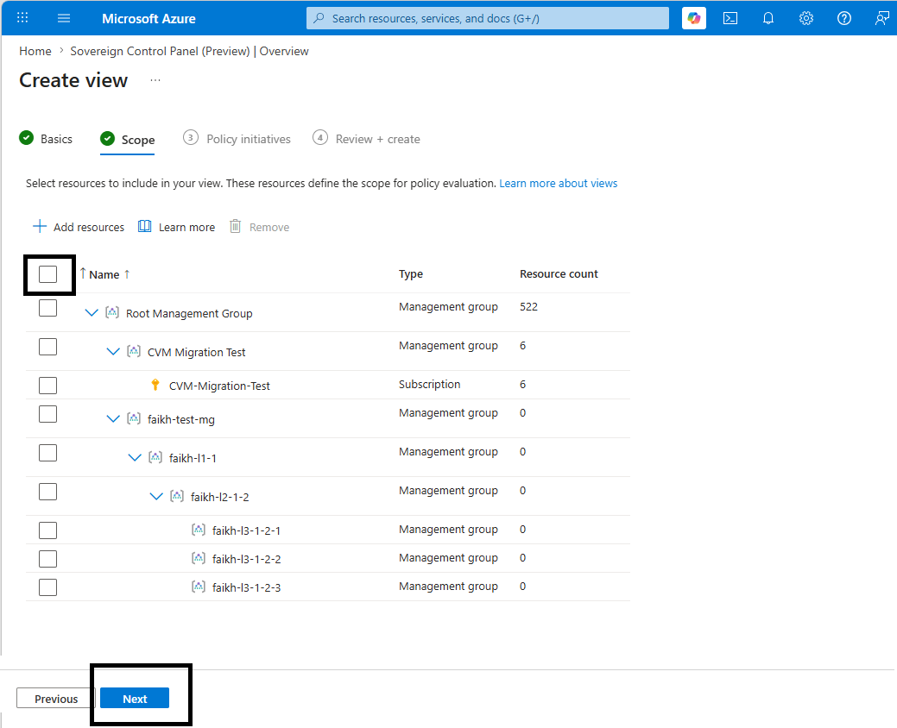
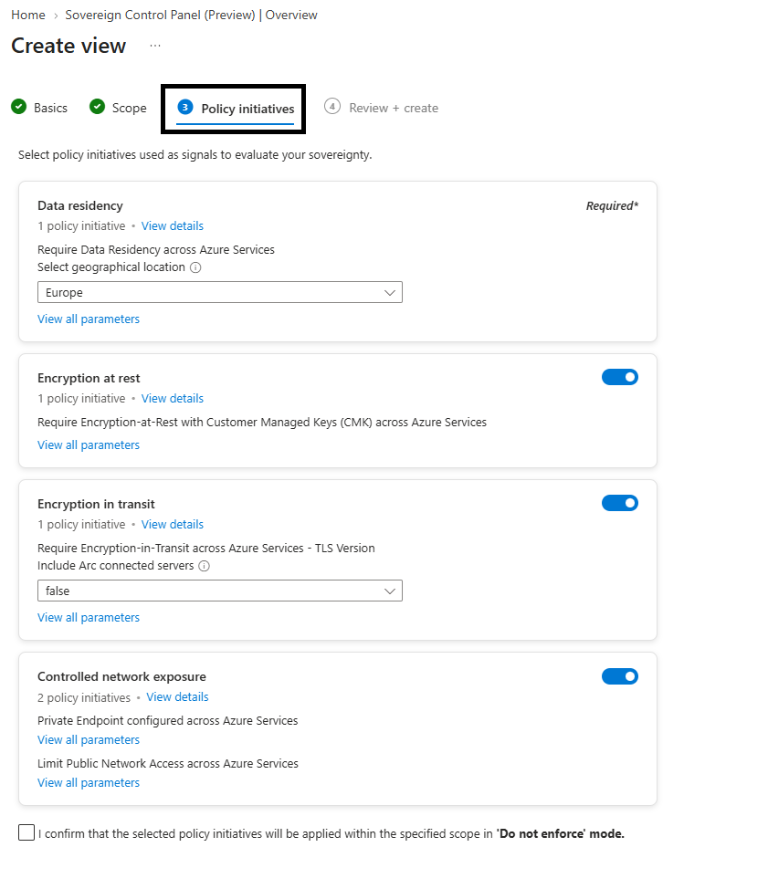
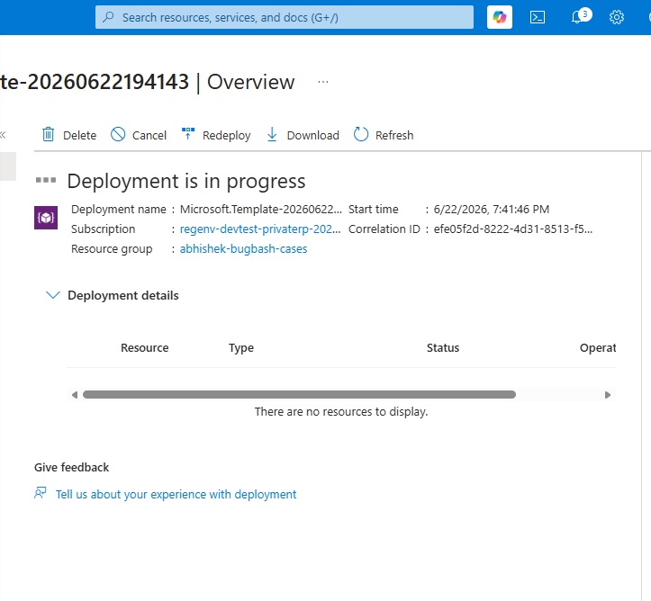

# Create a Sovereign View

After the resource provider is registered, you can create a Sovereign View resource. You can create it only on the subscriptions (in an allowlisted tenant) that you provided in the onboarding form.

## Prerequisites

- Complete [Module 2: Register the resource provider](/docs/how-to/02-register-resource-provider.md).
- Have **Contributor + Resource Policy Contributor** or **Owner** on the target subscription.

## Start the create experience

| # | Step | Screenshot |
| :-: | --- | --- |
| 1 | In the Azure portal's top search bar, type **Sovereign**, then select **Sovereign Control Panel**. |  |
| 2 | On the overview page, **select Create View**. |  |

## Complete the Basics tab

| # | Step | Screenshot |
| :-: | --- | --- |
| 1 | The **Create view** page opens with the **Subscription** and **Resource group** prefilled. |  |
| 2 | On the **Basics** tab, fill in the details: • **Subscription** — Choose the subscription where you want to create this Sovereign view resource (the same subscription you registered above). . • **Resource group** — Select an existing resource group or create a new one to host the Sovereign view resource. . • **Name** — Enter a name for your Sovereign view resource [doesn’t allow space]. • **Region** — Choose an Azure region for the resource. (This is simply where the metadata and processing for the resource will reside). . |  |
| 3 | Select **Next** to move to the **Scope** tab. |  |

## Select the scope

As you add scopes, SCP checks whether you have permission to assign roles on each subscription and management group, and shows the result in the **Role assignment** column:

- **Yes** — SCP automatically assigns the **Reader** and **Resource Policy Contributor** roles to the Sovereign View's managed identity when the view is created. **Owner** or **User Access Administrator** on the scope provides this capability.
- **No** — You can still select the scope and create the view, but SCP can't assign the roles automatically. Ask an **Owner** or **User Access Administrator** for the scope to assign the roles, then verify the permission status after deployment.

| # | Step | Screenshot |
| :-: | --- | --- |
| 1 | On the **Scope** tab, select **+ Add resources**. SCP checks your role assignment permission for every subscription and management group shown in **Add resources**. |  |
| 2 | You can choose a **Management Group** (to include all subscriptions under it) or/and one or more specific **Subscriptions** to be included in this Sovereign view. Use the UI controls to select the desired management group and/or subscription(s) from the list. |  |
| 3 | After selecting the resources, select **Add** at the bottom. SCP shows the permission result for each scope in the **Role assignment** column — **Yes** means the roles are assigned automatically at creation; **No** means an **Owner** or **User Access Administrator** must assign them after the view is created. |  |
| 4 | On the **Scope** page, remove any subscriptions or management groups you don't want to include for scope assessment by selecting them and choosing **Remove**. When your selection is complete, select **Next** to continue. |  |

## Configure the policy initiative

The Sovereign view focuses on specific dimensions or control sets (e.g., Data Residency, Encryption at Rest, etc.) relevant to data sovereignty. All your scoped resources will be evaluated against these policy initiatives. Data Residency is a mandatory policy initiative, the rest two are optional. 

| # | Step | Screenshot |
| :-: | --- | --- |
| 1 | On the **Policy initiative** tab, review the settings: • **Data Residency (Geography)** — In the current preview, the default value of Europe will be available.  • **Encryption at rest** – Select this if you want to evaluate your resources for this policy initiative.   • **Controlled Network Exposure** – Select this if you want to evaluate your resources against the two policy initiatives defined in this dimension. |  |
| 2 | Check the **“I confirm”** to allow SCP to proceed with creating the resource and associated policy assignments.  All policy assignments are created in non-enforcing. Azure Sovereign view does not block any operations or auto-remediate; it only reports sovereign control data.  Once done click next at the bottom to finally review and create the Sovereign view. . |  |

> [!TIP]
> To learn more about any Azure policy, see its definition on the [Azure Policy](https://ms.portal.azure.com/#view/Microsoft_Azure_Policy/PolicyMenuBlade.MenuView/~/Definitions) page in the portal, or the [list of built-in policy definitions](https://learn.microsoft.com/azure/governance/policy/samples/built-in-policies).

## Review and create

| # | Step | Screenshot |
| :-: | --- | --- |
| 1 | On the **Review + create** tab, verify all configuration details (scope, name, region, etc.). Then check the box and click Create to deploy the Sovereign view resource. |  |
| 2 | Post clicking the **Create** button, within few seconds the deployment will be completed, and your Sovereign view resource will be generated.. |  |

The deployment completes within a few seconds, and your Sovereign View resource is created.

## Next steps

- [Assign managed identity roles](/docs/how-to/04-assign-managed-identity-roles.md)
