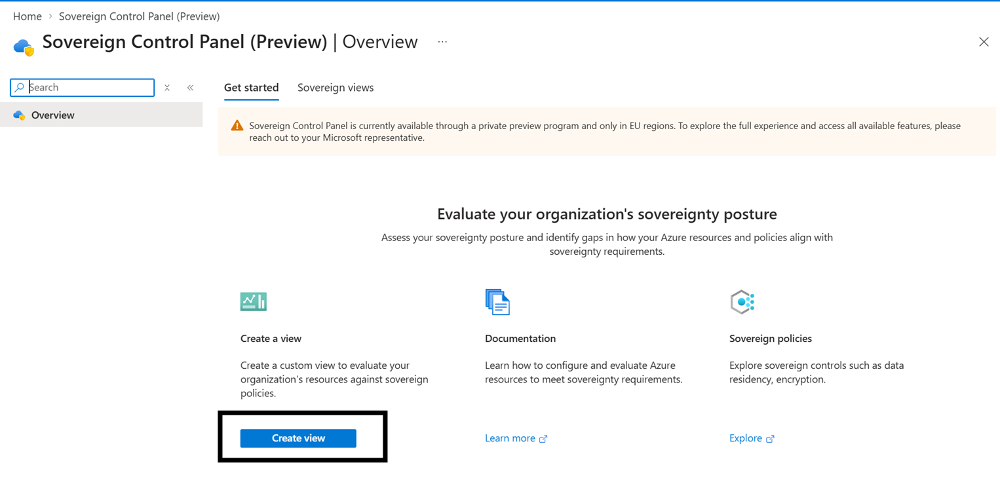
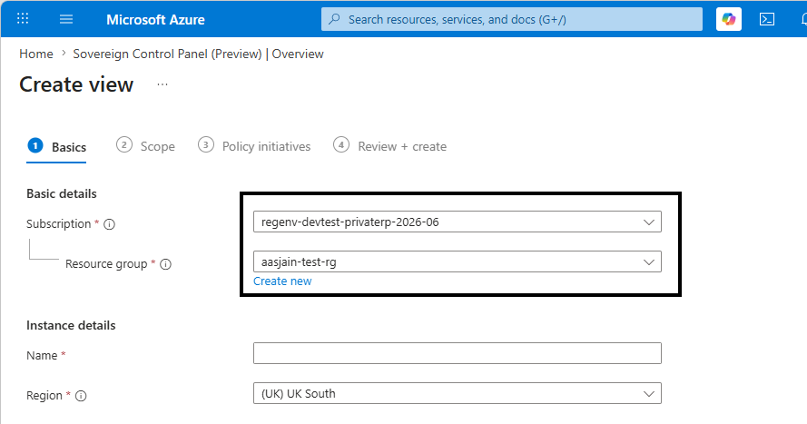
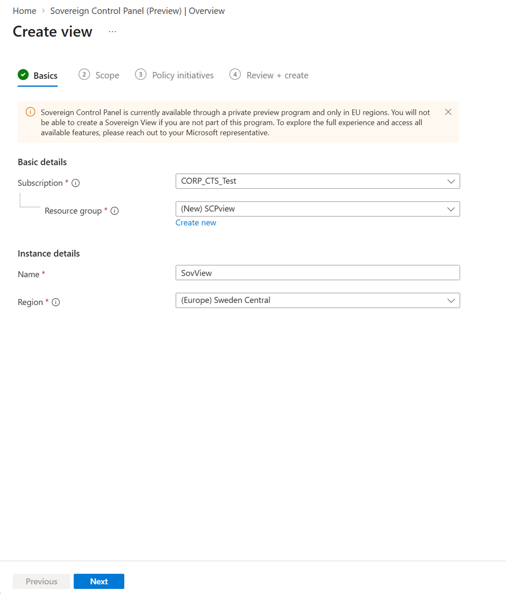
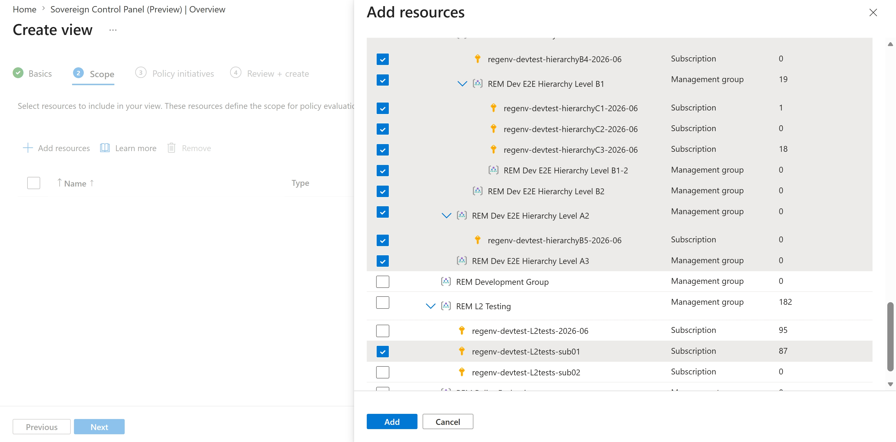

# Create a Sovereign View

After the resource provider is registered, you can create a Sovereign View resource. You can create it only on the subscriptions (in an allowlisted tenant) that you provided in the onboarding form.

## Prerequisites

- Complete [Module 2: Register the resource provider](/docs/how-to/02-register-resource-provider.md).
- Have **Contributor + Resource Policy Contributor** or **Owner** on the target subscription.

## Start the create experience

| # | Step | Screenshot |
| :-: | --- | --- |
| 1 | In the Azure portal's top search bar, **type Sovereign**, then select **Sovereign Control Panel**. |  |
| 2 | On the overview page, **select Create View**. |  |

## Complete the Basics tab

| # | Step | Screenshot |
| :-: | --- | --- |
| 1 | The **Create view** page opens with the **Subscription** and **Resource group** prefilled. |  |
| 2 | On the **Basics** tab, fill in the details: • **Subscription** — the subscription you registered earlier. • **Resource group** — an existing one, or create a new one. • **Name** — a name for the resource (spaces aren't allowed). • **Region** — where the resource metadata and processing reside. |  |
| 3 | Select **Next** to move to the **Scope** tab. |  |

## Select the scope

| # | Step | Screenshot |
| :-: | --- | --- |
| 1 | On the **Scope** tab, select **+ Add resources**. |  |
| 2 | Choose either a **Management group** (to include all subscriptions under it) or one or more specific **Subscriptions** to include in this Sovereign View. |  |
| 3 | After selecting the resources, select **Add**. |  |
| 4 | Select the items to include (or the checkbox next to **Name** for all), then select **Next**. |  |

## Configure the policy initiative

The Sovereign View focuses on specific control sets (for example, Data Residency or Encryption at Rest) relevant to data sovereignty. In the preview, these are largely predefined and selected for you.

| # | Step | Screenshot |
| :-: | --- | --- |
| 1 | On the **Policy initiative** tab, review the settings: • **Data Residency (Geography)** — the default value of **Europe** is selected. • Review the policies or controls that will be evaluated (for example, *Data sovereignty control levels* or *Encryption at rest*). |  |
| 2 | Select **I confirm**, then select **Next**. Validation takes a few seconds. |  |

> [!TIP]
> To learn more about any Azure policy, see its definition on the [Azure Policy](https://portal.azure.com) page in the portal, or the [list of built-in policy definitions](https://learn.microsoft.com/azure/governance/policy/samples/built-in-policies).

## Review and create

| # | Step | Screenshot |
| :-: | --- | --- |
| 1 | On the **Review + create** tab, verify all configuration details (scope, name, region, and so on). |  |
| 2 | Select the confirmation checkbox, then select **Create** to deploy the Sovereign View resource. |  |

The deployment completes within a few seconds, and your Sovereign View resource is created.

## Next steps

- [Assign managed identity roles](/docs/how-to/04-assign-managed-identity-roles.md)
