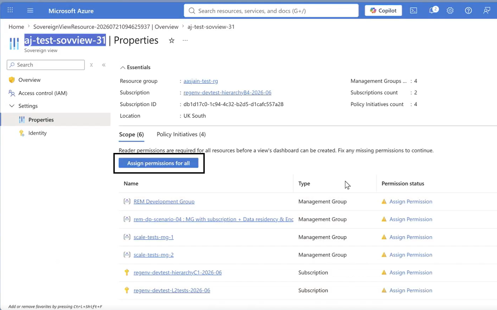

# Assign managed identity roles

After you create a Sovereign View, you must grant its managed identity read access so it can collect data and generate the sovereignty control report. 

The Sovereign View's **Properties** page can assign the managed identity roles for you. On the Properties tab, the view checks whether its managed identity already has the access to each in-scope subscription and management group, and lets you grant any missing **Reader** role in a single action. 

> [!NOTE]
>To use **Assign permissions for all**, you need **Owner** or **User Access Administrator** on each scope, because assigning roles requires that permission. 

## Prerequisites

- Complete [Module 3: Create a Sovereign View](/docs/how-to/03-create-sovereign-view.md).
- Have **Owner** or **User Access Administrator** permission to assign Azure roles.

## Confirm the identity assignment permission

| # | Step | Screenshot |
| :-: | --- | --- |
| 1 | On the Sovereign View page select Settings > Properties. Review the Permission status column. Items where the managed identity is missing access show ⚠ Assign Permission. |  |
| 2 | Select **Assign permissions** for all to grant the required roles to every in-scope item at once.  |  |
| 3 |Each item moves from **Assigning** to **Assigned**, and a **Permissions assigned** notification confirms the roles were granted to the managed identity. |  |

## If the assignment isn't available 

If Assign permissions for all is disabled, get the necessary permissions.

| Symptom  | Cause and fix | Screenshot |
| :-: | --- | --- |
|  A scope shows **No access** and the button is disabled. |You don't have rights to assign roles on that scope. Request **Owner** or** User Access Administrator** access for the scope (or ask someone who has it to run the assignment). |  |
| A **Managed identity** **details are missing** banner appears and the button is disabled. | The view's system-assigned managed identity isn't enabled. Open **Settings** > **Identity**, set the **System assigned** status to **On** . | |

## Verify Access 

| # | Step | Screenshot |
| :-: | --- | --- |
| 1 | On the Sovereign View, open **Access control (IAM)** > **Role assignments** and filter by the view name. Confirm the managed identity holds both the **Reader** role. . |  |

## Report generation

Once the above role assignments are in place, the Sovereign view will begin collecting data. An initial scan will be completed within 24 hours.

## Next steps

- [View the sovereignty control report](/docs/how-to/05-view-compliance-report.md)
