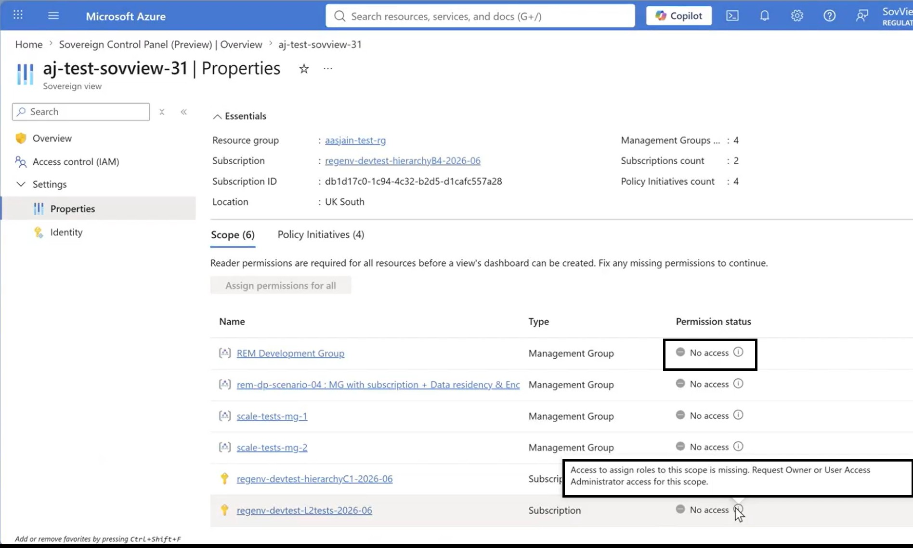
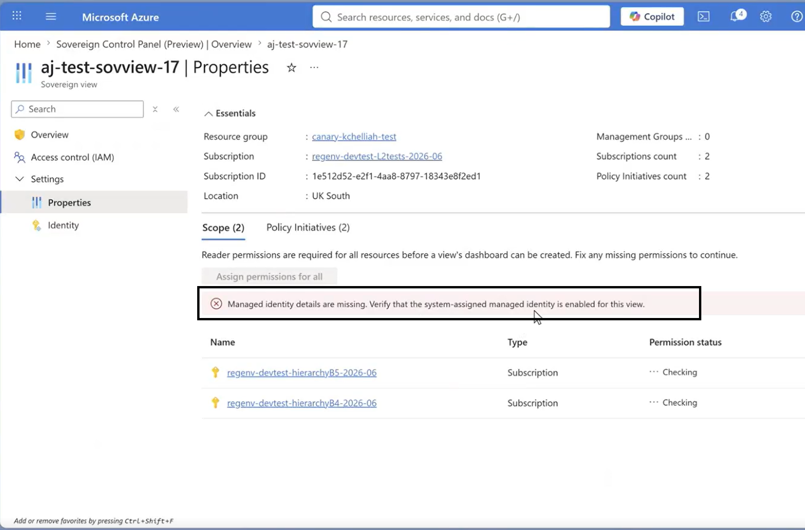

# Assign managed identity roles

After you create a Sovereign View, its managed identity needs access to every in-scope subscription and management group so it can collect data and generate the sovereignty control report.

When the Sovereign View is created, Sovereign Control Panel (SCP) automatically attempts to grant the managed identity the required access on each scope where you have permission to assign roles. The steps in this module are needed only when a permission is missing or the automatic assignment fails.

The Sovereign View's **Properties** page shows the current access for each scope and lets you grant the missing roles in a single action.

> [!NOTE]
> To assign roles, you need **Owner** or **User Access Administrator** on each scope.

## Prerequisites

- Complete [Module 3: Create a Sovereign View](/docs/how-to/03-create-sovereign-view.md).
- Have **Owner** or **User Access Administrator** permission on each in-scope subscription and management group to assign Azure roles.

## Assign the missing permissions

| # | Step | Screenshot |
| :-: | --- | --- |
| 1 | On the Sovereign View page, select **Settings** > **Properties**. Review the **Permission status** column. Scopes where the managed identity is missing access show ⚠ **Assign Permission**. |  |
| 2 | Select **Assign permissions for all**. This is the recommended first action, because it grants the required roles to every in-scope item at once. The bulk action grants both the **Reader** and **Resource Policy Contributor** roles, whereas assigning permission on an individual row grants only the **Reader** role. |  |
| 3 | Each item moves from **Assigning** to **Assigned**, and a **Permissions assigned** notification confirms that the roles were granted to the managed identity. |  |

## If the assignment isn't available

If the assignment action is disabled, use the following table to identify the cause.

| Symptom | Cause and fix | Screenshot |
| :-: | --- | --- |
| A scope shows **No access** and the button is disabled. | You don't have rights to assign roles on that scope. Request **Owner** or **User Access Administrator** access for the scope, or ask someone who has it to run the assignment. |  |
| A **Managed identity details are missing** banner appears and the assignment action is disabled. | The view's system-assigned managed identity isn't enabled. Open **Settings** > **Identity**, and set the **System assigned** status to **On**. Then return to **Properties** and assign the permissions again. |  |

## Verify access

| # | Step | Screenshot |
| :-: | --- | --- |
| 1 | On the Sovereign View, open **Access control (IAM)** > **Role assignments** and filter by the view name. Confirm the managed identity's role assignments: **Reader** and **Resource Policy Contributor** when the roles were granted with **Assign permissions for all**, or **Reader** only when a scope was assigned from an individual row. |  |

## Report generation

After the role assignments are in place, the Sovereign View begins collecting data.

1. From the Sovereign View **Overview** page, open **Properties**.
1. Confirm that dashboard generation has started.
1. Review the status information for each scope, even if the role-assignment permission was previously reported as **Yes**.

An initial scan completes within 24 hours.

## Next steps

- [View the sovereignty control report](/docs/how-to/05-view-compliance-report.md)
