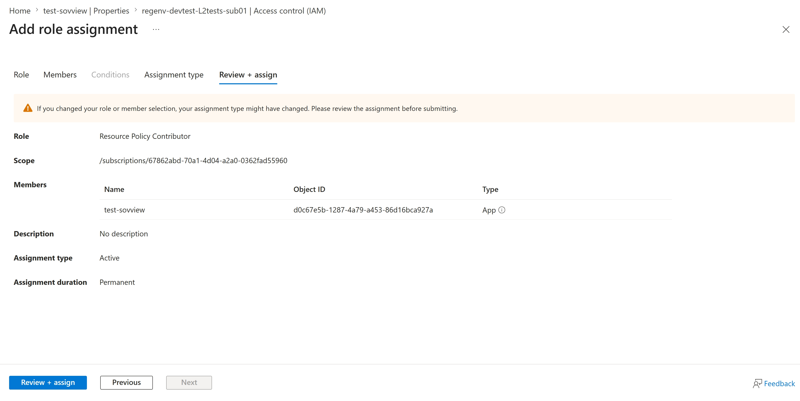
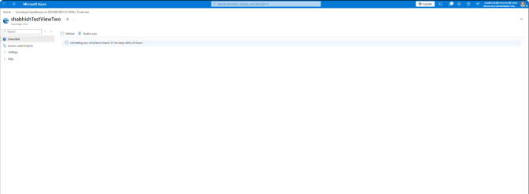
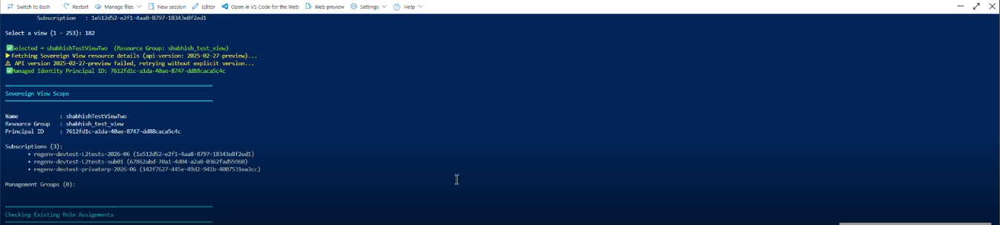
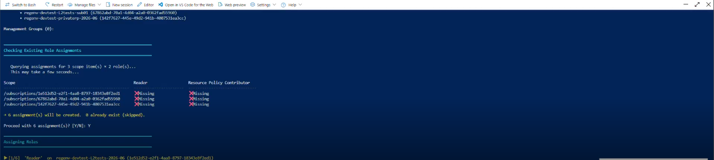

# Assign managed identity roles

After you create a Sovereign View, you must grant its managed identity read access to your environment so it can collect data and generate the sovereignty control report.

The Sovereign View resource has a **system-assigned managed identity**. For each subscription and management group in the view's scope, assign this identity the **Reader** and **Resource Policy Contributor** roles. You can do this manually in the Azure portal or by running a PowerShell script.

## Prerequisites

- Complete [Module 3: Create a Sovereign View](/docs/how-to/03-create-sovereign-view.md).
- Have **Owner** or **User Access Administrator** permission to assign Azure roles.

## Confirm the identity assignment permission

| # | Step | Screenshot |
| :-: | --- | --- |
| 1 | After a successful deployment, select **Go to resource** to open the Sovereign View resource. |  |
| 2 | On the left side, click properties under settings and check if you have the identity assignment permission as **Yes**.  _This means you have the permission to assign the required role to managed identity for the selected scopes_   If **No**, either ask someone who has the User Access Admin or owner role and get the managed identity the required roles assigned or get User access administration permission.  |  |

Once you get the User Access Administrator permission, follow below steps to assign required roles to the Managed Identity. The Sovereign view resource has a system-assigned managed identity. You can assign its roles manually in the Azure portal or by running a PowerShell script 
> [!NOTE]
>Assign **Reader** and **Resource policy contributor** to the Identity: For each subscription and management group that you included in the Sovereign view scope, you must assign this managed identity the Reader and Resource policy contributor roles. This can be done manually or via Powershell script. 

## Option 1: Assign roles manually

| # | Step | Screenshot |
| :-: | --- | --- |
| 1 | In the Sovereign View, select **Properties**, then select a management group or subscription in scope, **one at a time**. |  |
| 2 |Click **Access control (IAM)**, and then click + **Add** and select > Add role assignment from the dropdown. **+ Add** > **Add role assignment**. | |
| 3 | **Search for Reader**, and select it. | |
| 4 | In **Assign access to**, choose **User, group, or service principal**, then search for and select the Sovereign View's managed identity (it appears as a service principal). |  |
| 5 | Select **Review + assign** to finalize the role assignment. |  |
| 6 | Repeat the steps above to also assign the **Resource Policy Contributor** role to the same managed identity. | 
| 7 |Post clicking the Next button, user has to add the id to the get the resource added.|  |
| 8 | Select **Review + assign** to finalize the role assignment. | |

Repeat this process for **each** subscription and management group in your Sovereign View scope. This grants the Sovereign View permission to read the configuration of resources in those scopes.

## Option 2: Assign roles by using the PowerShell script

The [`assign-roles.ps1`](/docs/scripts/assign-roles.ps1) script grants the view's managed identity the **Reader** and **Resource Policy Contributor** roles across the in-scope subscriptions so it can read resources and evaluate policy.

| # | Step | Screenshot |
| :-: | --- | --- |
| 1 | **Open the Sovereign View**. |  |
| 2 | Select **PowerShell** at the top of the portal to open **Azure Cloud Shell**. |  |
| 3 | In Cloud Shell, Open **Manage files** > **Upload**, and upload the [`assign-roles.ps1`](/docs/scripts/assign-roles.ps1) script. |   |
| 4 | **Run the script** with `./assign-roles.ps1`. It verifies your sign-in, installs the resource-graph extension (one time), and lists the available Sovereign Views. |  |
| 5 | **Select the target view** Enter the number of your Sovereign view. The script retrieves the view’s Managed Identity Principal ID and displays its scope — the subscriptions and management groups assigned to the view. |  |
| 6 | **Confirm the role assignments** The script checks existing assignments and shows which of the required roles — Reader and Resource Policy Contributor — are missing for each scope item. Review the planned assignments and enter Y to proceed. . |  |
| 7 | **Roles assigned** The script assigns Reader and Resource Policy Contributor to the managed identity on each in-scope subscription and prints a summary of the results. . |  |

> [!TIP]
> Run `./assign-roles.ps1 -DryRun` first to preview the assignments without making any changes.

## Report generation

Once the above role assignments are in place, the Sovereign view will begin collecting data. An initial scan will be completed within 24 hours.

## Verify Access
If the report does not generate or remains empty, double-check that the managed identity indeed has Reader rights on all relevant scopes (e.g., if you selected a management group containing multiple subscriptions, ensure it has access at the management group level – it will inherit down to contained subscriptions).  

## Next steps

- [View the sovereignty control report](/docs/how-to/05-view-compliance-report.md)
