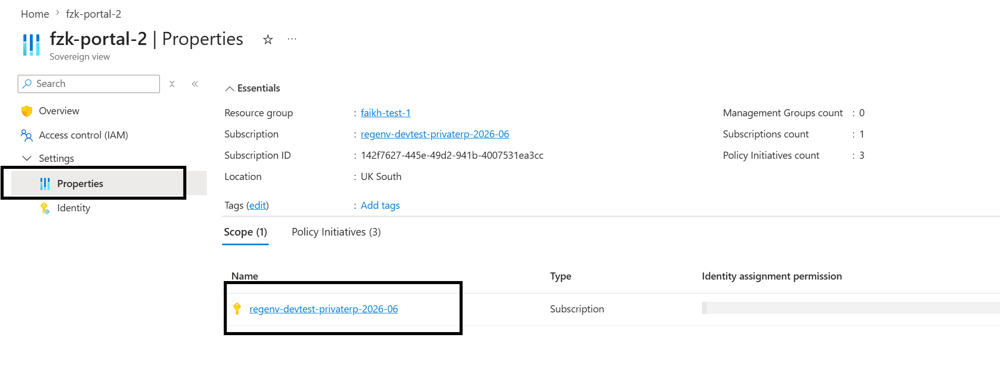
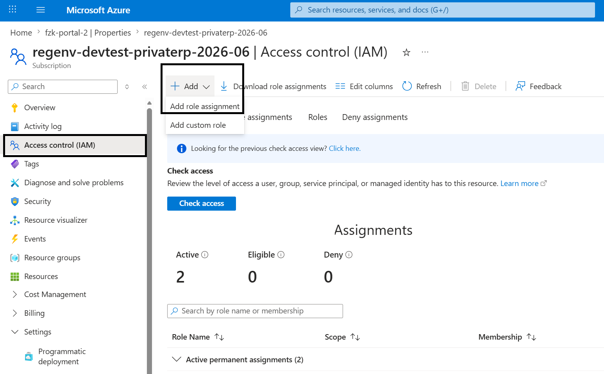
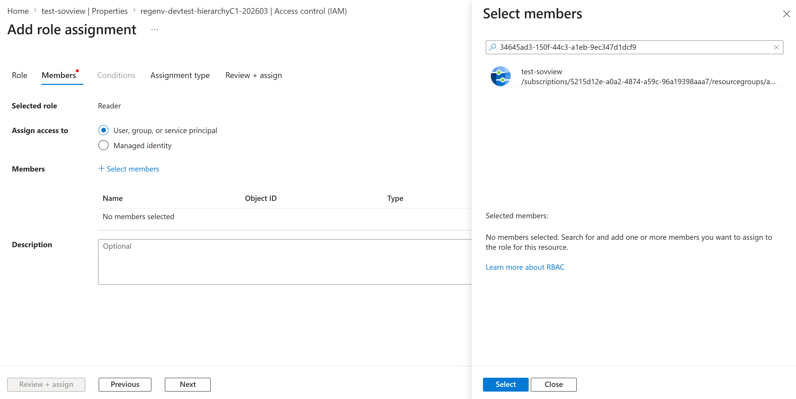
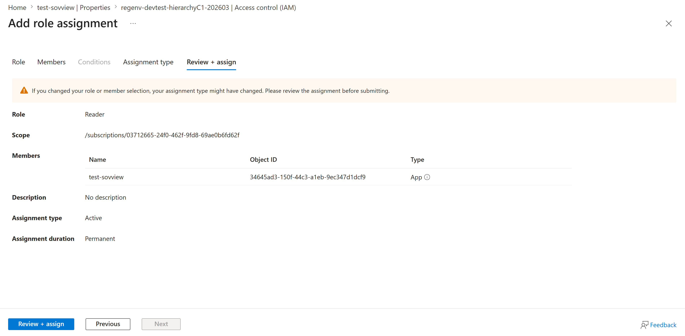
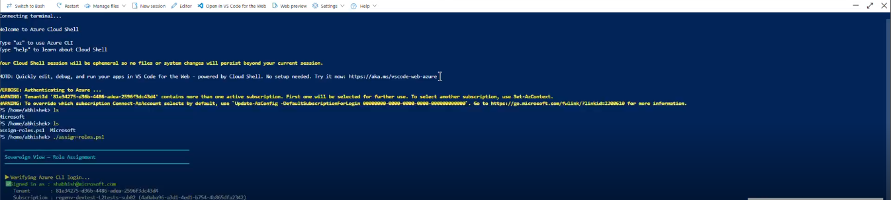
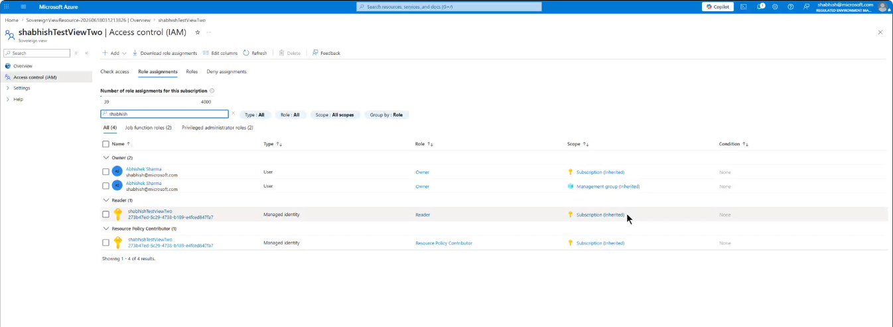
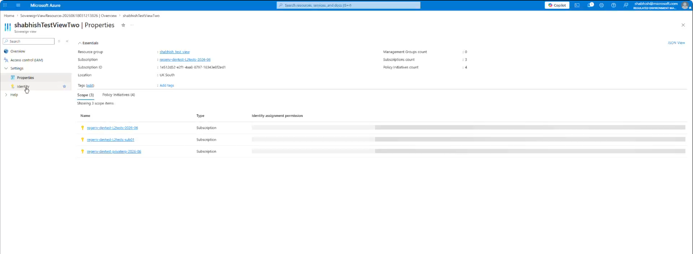

# Assign managed identity roles

After you create a Sovereign View, you must grant its managed identity read access to your environment so it can collect data and generate the sovereignty control report.

The Sovereign View resource has a **system-assigned managed identity**. For each subscription and management group in the view's scope, assign this identity the **Reader** and **Resource Policy Contributor** roles. You can do this manually in the Azure portal or by running a PowerShell script.

## Prerequisites

- Complete [Module 3: Create a Sovereign View](/docs/how-to/03-create-sovereign-view.md).
- Have **Owner** or **User Access Administrator** permission to assign Azure roles.

## Confirm the identity assignment permission

1. After a successful deployment, select **Go to resource** to open the Sovereign View resource.

   

1. In the left menu, under **Settings**, select **Properties** and check whether **Identity assignment permission** is set to **Yes**.

   

   If it's set to **No**, obtain the Reader permission needed to assign the managed identity before continuing.

The Sovereign View resource has a system-assigned managed identity. You can assign its roles manually in the Azure portal or by running a PowerShell script.


## Option 1: Assign roles manually



1. In the Sovereign View, select **Properties**, and then select a management group or subscription in scope, one at a time.

   

1. On the subscription (or management group) page, select **Access control (IAM)**, then select **+ Add** > **Add role assignment**.

   

1. Search for **Reader**, and select it.

   

1. In **Assign access to**, choose **User, group, or service principal**. Search for the name of the Sovereign View's managed identity (it appears as a service principal) and select it.

   

1. Select **Review + assign** to finalize the role assignment.

   

1. Repeat the steps above to also assign the **Resource Policy Contributor** role to the same managed identity.

   

   

Repeat this process for **each** subscription and management group in your Sovereign View scope. This grants the Sovereign View permission to read the configuration of resources in those scopes.

## Option 2: Assign roles by using the PowerShell script

The [`assign-roles.ps1`](/docs/scripts/assign-roles.ps1) script grants the view's managed identity the **Reader** and **Resource Policy Contributor** roles across the in-scope subscriptions so it can read resources and evaluate policy.

1. Open the Sovereign View.

   

1. Select **PowerShell** at the top of the portal to open **Azure Cloud Shell**.

   

1. In Cloud Shell (PowerShell), select **Manage files** > **Upload**, and upload the [`assign-roles.ps1`](/docs/scripts/assign-roles.ps1) script.

   

   

1. Run the script:

   ```powershell
   ./assign-roles.ps1
   ```

   The script verifies your Azure sign-in, installs the resource-graph extension (one time), and lists the available Sovereign Views.

   

1. Enter the number of your Sovereign View. The script retrieves the view's managed identity principal ID and displays its scope — the subscriptions and management groups assigned to the view.

   

1. Review the planned assignments. The script shows which of the required roles (**Reader** and **Resource Policy Contributor**) are missing for each scope item. Enter **Y** to proceed.

   

   The script assigns the roles to the managed identity on each in-scope subscription and prints a summary.

   

   > [!TIP]
   > Run `./assign-roles.ps1 -DryRun` first to preview the assignments without making any changes.

## Verify the assignments

1. On the Sovereign View, open **Access control (IAM)** > **Role assignments** and filter by the view name. Confirm the managed identity holds both the **Reader** and **Resource Policy Contributor** roles.

   

1. Open **Settings** > **Properties**. On the **Scope** tab, each subscription shows its **Identity assignment permission** status, confirming the managed identity has the access it needs to evaluate the view.

## Report generation

After the role assignments are in place, the Sovereign View begins collecting data. An initial scan completes within 24 hours.

If the report doesn't generate or remains empty, confirm that the managed identity has Reader rights on all relevant scopes. If you selected a management group that contains multiple subscriptions, make sure access is assigned at the management group level so it inherits down to the contained subscriptions.

## Next steps

- [View the sovereignty control report](/docs/how-to/05-view-compliance-report.md)
