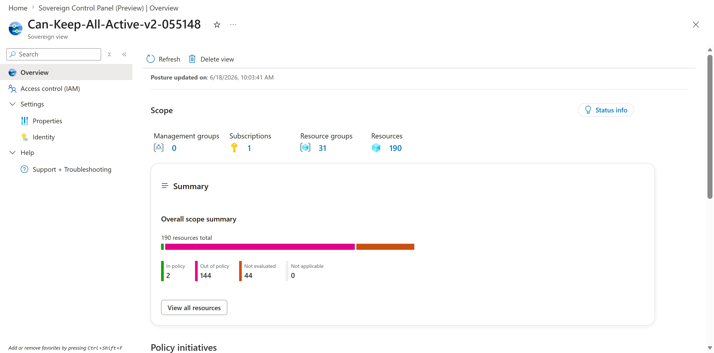
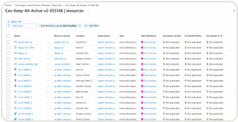
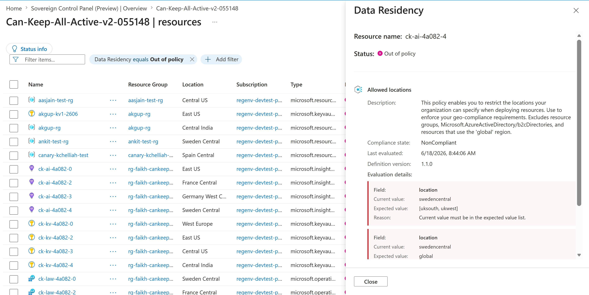

# View the sovereignty control report

After data collection is complete, your Sovereign View resource presents a sovereignty control report in the Azure portal. This guide explains how to read the report and manage the resource over time.

## Prerequisites

- Complete [Module 4: Assign managed identity roles](/docs/how-to/04-assign-managed-identity-roles.md).
- Allow up to 24 hours after the role assignments for the initial scan to complete.

## Read the report

After data collection is complete, your Sovereign View resource presents a sovereignty control report in the Azure portal.

| Area | What you see | Screenshot |
| --- | --- | --- |
| **Report dashboard** | Navigate to your Sovereign View resource in the Azure portal. The **Overview** tab displays a summary of results — typically the overall status of the selected scope, with a breakdown by control category (such as data residency or encryption). |  |
| **Reasoning and definitions** | For each control or policy listed, you can **drill down** for more information about what it checks. Definitions are available on the Azure Policy definition page in the portal. For this preview, the definitions correspond to sovereignty best practices such as encryption and data location restrictions. |  |

## Manage the resource

The Sovereign View resource periodically refreshes its data (for example, every 24 hours, or as policies trigger scans). You don't need to re-run anything manually — check the resource page for updated sovereign control status over time.

## Next steps

- [Delete a Sovereign View](/docs/how-to/06-delete-sovereign-view.md)
- [Troubleshooting and support](/docs/how-to/07-troubleshooting-and-support.md)
