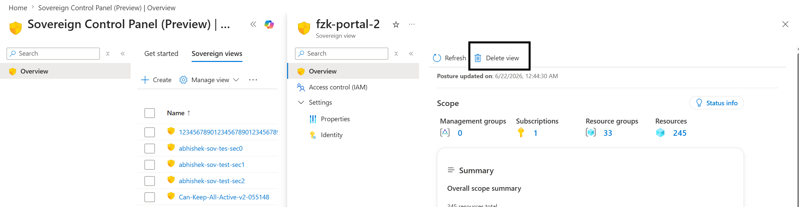

# Delete a Sovereign View

This guide explains how to delete a Sovereign View resource and what happens when you remove it.

## Prerequisites

- An existing Sovereign View resource. See [Module 3: Create a Sovereign View](/docs/how-to/03-create-sovereign-view.md).
- **Contributor** or **Owner** rights on the subscription, and **Resource Policy Contributor** permission on the in-scope subscriptions and management groups.

## Delete the resource

You can delete the Sovereign View resource from the Azure portal by selecting **Delete** on the resource's page, just like any other Azure resource.

## What happens when you delete

Deleting the resource removes its managed identity and any stored data. It doesn't affect any of your other resources or configurations — it simply deletes the Sovereign View.

If you need the view again later, recreate the resource and reassign permissions. See [Module 3: Create a Sovereign View](/docs/how-to/03-create-sovereign-view.md) and [Module 4: Assign managed identity roles](/docs/how-to/04-assign-managed-identity-roles.md).

## Next steps

- [Troubleshooting and support](/docs/how-to/07-troubleshooting-and-support.md)
