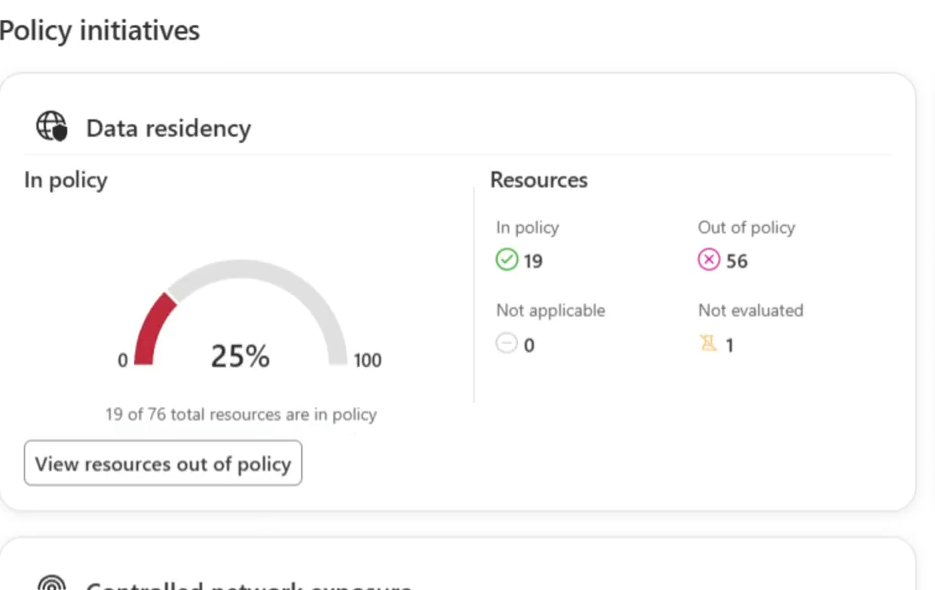
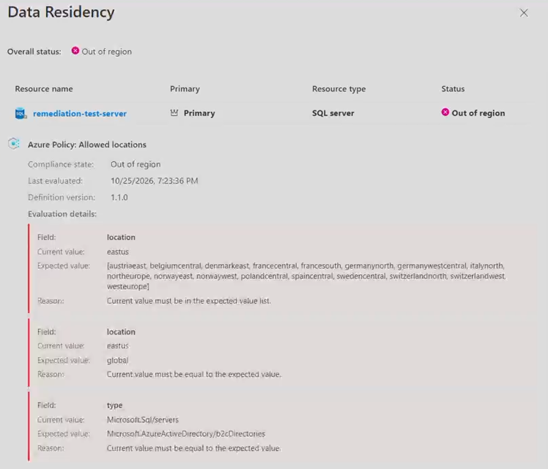
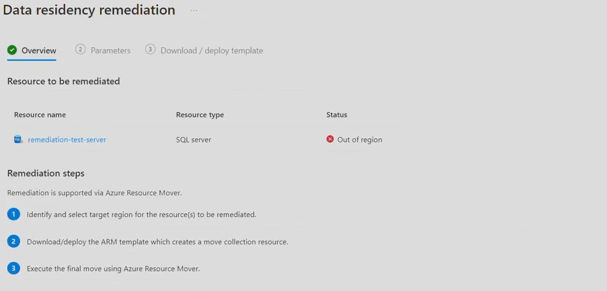
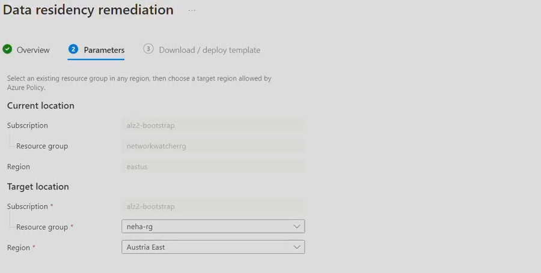
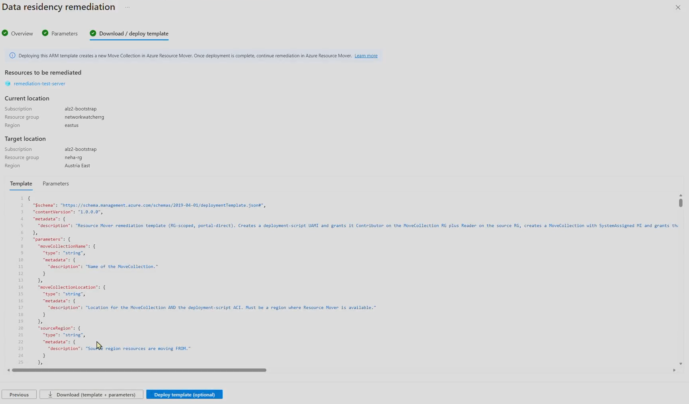
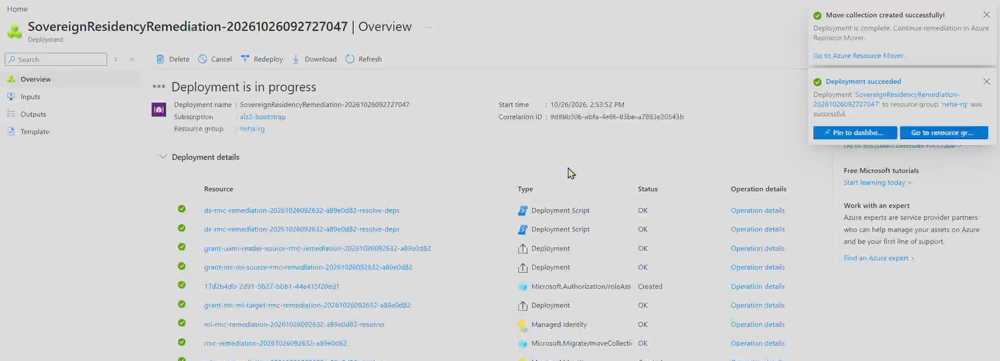
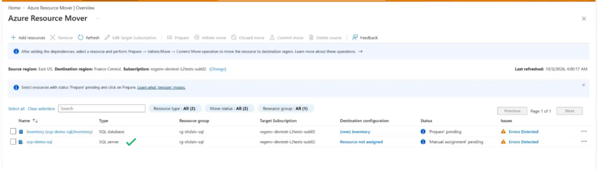
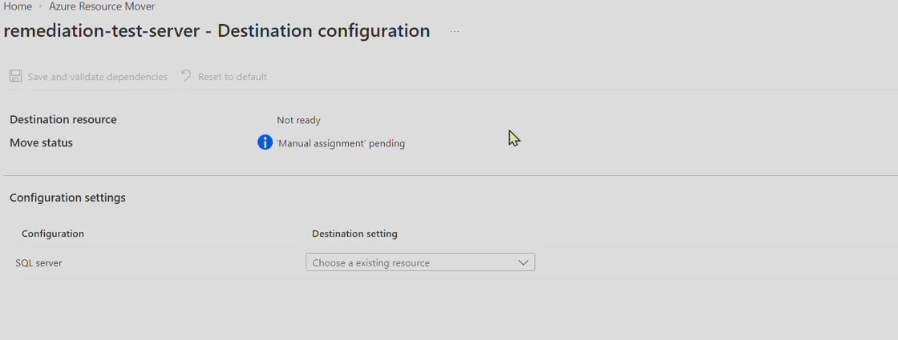
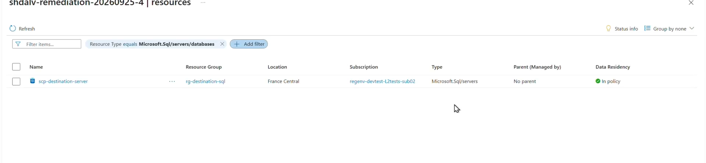

# Remediate Data Residency issues

Use this guide to remediate eligible out-of-region Data Residency findings from a Sovereign View. You review a generated Azure Resource Manager (ARM) template and explicitly deploy it to create a Move Collection and register the resource and its dependencies in Azure Resource Mover. You then complete the resource move in Azure Resource Mover.

> [!IMPORTANT]
> **Template deployment is not the move.** A successful ARM deployment confirms setup, not completion of the resource move or an updated compliance result. The SCP summary updates after the next policy evaluation cycle, every 24 hours.

## What this experience does

| Stage | What you do |
| --- | --- |
| Discover | Open a Sovereign View, identify an out-of-region residency finding, and start remediation. |
| Configure | Confirm the source and choose an existing target resource group and a region allowed by Azure Policy. |
| Set up | Review and download the ARM template and parameters, or deploy the template to create a Move Collection and register the resource and its dependencies. |
| Move and verify | Complete the Resource Mover operations, validate the target workload, and recheck residency after the next policy evaluation cycle. |

## Prerequisites and permissions

- Have an existing [Sovereign View](/docs/how-to/03-create-sovereign-view.md) with an available [sovereignty control report](/docs/how-to/05-view-compliance-report.md).
- Identify an eligible primary resource with an **Out of region** finding.
- Select an existing target resource group and a destination region allowed by Azure Policy.
- Obtain workload-owner approval and any required change approval before deployment or move operations.

| Action | Required role | Where |
| --- | --- | --- |
| View the residency report | Reader | The Sovereign View. |
| Deploy the remediation template | Contributor + User Access Administrator, or Owner | At the subscription level, or on both the source resource group and the selected target resource group. |

Contributor alone cannot create the role assignments needed by the template. If you do not have deployment access, download the template and parameters and ask an authorized administrator to deploy them.

The template creates the managed identities and role assignments used for setup. You do not need to configure these individually before starting.

### Keep the three principals separate

| Principal | Responsibility |
| --- | --- |
| Deploying user | Submits the deployment and creates resources and role assignments. |
| Script-runner user-assigned managed identity (UAMI) | Runs the setup script to register move resources and resolve dependencies. Use a narrowly scoped custom role for these operations, with separate Reader access on the source resource group. Review the generated template's role assignments before deployment. |
| Move Collection system-assigned managed identity | Performs the underlying Resource Mover resource operations, using Contributor on the source and target resource groups. |

## Supported resource types

SCP remediation is limited to eligible primary resources of the following types. Azure Resource Mover may support additional types that are not enabled for remediation in SCP.

| Supported resource |
| --- |
| Virtual machine |
| Availability set |
| Network interface |
| Virtual network |
| Public IP address |
| Network security group |
| Load balancer |
| SQL server |
| SQL database (Primary DB) |
| SQL elastic pool |

Associated disks move with a supported VM; standalone disk remediation is not offered in this experience. Resources outside this list are not supported. Check the [Resource Mover prerequisites](https://learn.microsoft.com/azure/resource-mover/move-region-within-resource-group) and [VM support matrix](https://learn.microsoft.com/azure/resource-mover/support-matrix-move-region-azure-vm) for configuration-specific restrictions, including operating systems, disks, and networking settings.

## Find the residency issue

| # | Step | Screenshot |
| :-: | --- | --- |
| 1 | In the Azure portal, open **Sovereign Control Panel (Preview)**, select your Sovereign View, and review the **Data residency** policy initiative. Select **View resources out of policy** to open the resources list. |  |
| 2 | Filter **Data Residency** to **Out of region**. Select the resource's residency status to open **Data Residency**. Review the primary resource, type, current region, last-evaluated time, and **Azure Policy: Allowed locations** evaluation. |  |
| 3 | Select **Initiate remediation** only for an eligible resource and a finding you intend to remediate. If the action is unavailable, check the supported resource types above and contact [support](/docs/how-to/07-troubleshooting-and-support.md#get-help-or-give-feedback). | |

## Configure remediation parameters

| # | Step | Screenshot |
| :-: | --- | --- |
| 1 | On **Overview**, confirm the resource name, resource type, and **Out of region** status. Review the three steps: target selection, template setup, and the final move in Azure Resource Mover. Select **Next**. |  |
| 2 | On **Parameters**, select an existing target **Resource group** and a region allowed by Azure Policy. Select **Next** to generate the remediation plan and template. If generation is in progress, wait for the JSON and deployment controls to become available. |  |
| 3 | On **Download / deploy template**, confirm **Resources to be remediated**, **Current location**, and **Target location**. Inspect both the **Template** and **Parameters** tabs before downloading or deploying. |  |

| Option | Use it when |
| --- | --- |
| **Download (template + parameters)** | You need offline review, change approval, or deployment by a privileged operator. Keep both files together and recheck their target values before use. |
| **Deploy template (optional)** | You have the required roles and approval to create the Move Collection and related resources in the selected target resource group. |

## Deploy and monitor the template

1. If approved, select **Deploy template (optional)**. Watch the notifications for submission and Move Collection creation, then open the Azure deployment record.
2. Wait for a terminal success or failure state. Open **Operation details** for any failed component. A created Move Collection alone does not prove that the setup script and all role assignments succeeded.

### Understand what setup creates

- An Azure Resource Mover Move Collection and its system-assigned managed identity.
- A script-runner user-assigned managed identity, role assignments, and nested deployments.
- A deployment script and supporting container and storage resources, as declared by the generated template.
- Move-resource registrations and dependency discovery performed by the setup script.

Review the resulting collection rather than assuming every dependency is resolved. Retain the deployment name, correlation ID, target resource group, and Move Collection name for troubleshooting and change records.

## Complete the move in Azure Resource Mover

1. Select the link in the **Move Collection created successfully** notification. Alternatively, open **Azure Resource Mover > Across regions** and select the subscription and source/destination region pair matching the created collection.
2. Confirm that the selected primary resource and its discovered dependencies appear. Check **Destination configuration**, **Status**, and **Issues** for each item.

| What you may see | Meaning and next action |
| --- | --- |
| **Manual assignment pending** | A destination resource has not been assigned. Open **Destination configuration** and choose a suitable target resource where required. |
| **Resource not assigned** | The item needs destination configuration. Selecting a target resource group does not mean a matching destination resource was created. |
| **Errors Detected** | Open the issue details, correct configuration or access, and resolve or revalidate dependencies. |
| **Prepare pending** | Resource Mover preparation is not complete. Review readiness and start **Prepare** only when the dependencies and settings are correct. |

### Complete destination configuration

For the SQL server example, open **Resource not assigned** and choose a suitable existing SQL server in the intended destination region. Save and validate dependencies when enabled. Use service-specific target settings for other supported resource types.

### Configure and execute the move

The remaining operations follow the official Resource Mover lifecycle. They are not additional automatic steps performed by the SCP template.

> [!WARNING]
> **Protect production workloads.** Prepare, Initiate move, and Commit have workload-specific effects. Stateful workloads such as VMs and SQL can incur downtime, and Commit can make stateful source resources inaccessible. Obtain the workload owner's approval and follow the official service guidance before executing these stages.

| Stage | Required operator action |
| --- | --- |
| Resolve dependencies | Add or map all required dependencies. Revalidate after target settings change. Do not ignore outstanding issues. |
| Prepare | Run **Prepare** and wait for completion. Preparation may include replication for stateful resources. |
| Initiate move | Execute **Initiate move** within the agreed maintenance window. |
| Validate target | Test application access, data integrity, networking, identities, and dependent services before committing. |
| Commit or Discard | **Commit** only after acceptance of the target. **Discard** follows the service-specific Resource Mover workflow; it is not a universal rollback guarantee. |
| Review source cleanup | After commit and target validation, assess remaining source resources and copies under your approved retention and cleanup process. |

## Verify residency and clean up

1. Check the destination resource's actual region and operational state in Azure. Validate the workload, not only the Move Collection status.
2. Return to the Sovereign View. Allow for the **24-hour policy evaluation cycle** before expecting changes in the compliance summary.
3. Check the fresh result. Confirm the expected location, applicable residency status, and evaluation timestamp. A stale result, an excluded resource, or a blank report is not evidence of successful remediation.

This deployment creates a managed identity that runs the setup script, holding Contributor on target resource group and reader on source resource group, it is only used while the script runs. Once you have committed the move in the Azure Resource Mover, you can delete the Move Collection and the identity; neither is removed automatically.

## Support and next steps

- [View the sovereignty control report](/docs/how-to/05-view-compliance-report.md)
- [Troubleshooting and support](/docs/how-to/07-troubleshooting-and-support.md)
- [Resource Mover across-region guidance](https://learn.microsoft.com/azure/resource-mover/move-region-within-resource-group)
- [VM across-region support matrix](https://learn.microsoft.com/azure/resource-mover/support-matrix-move-region-azure-vm)
